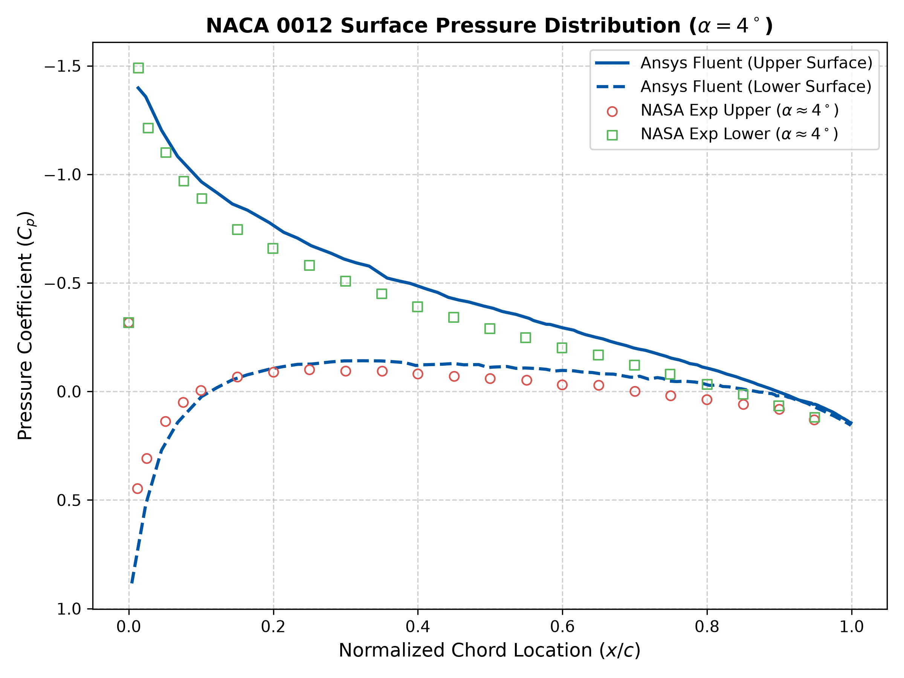
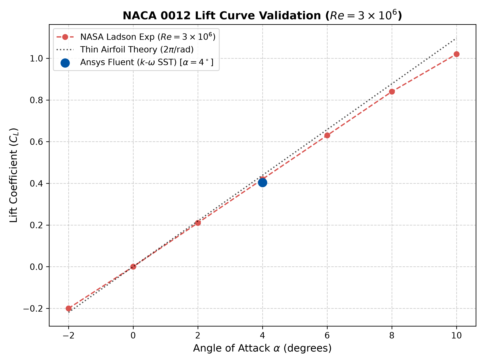
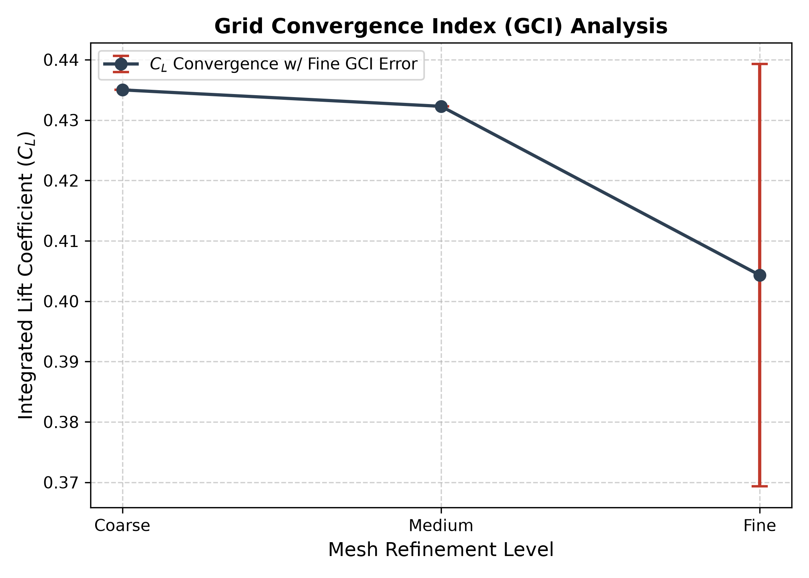
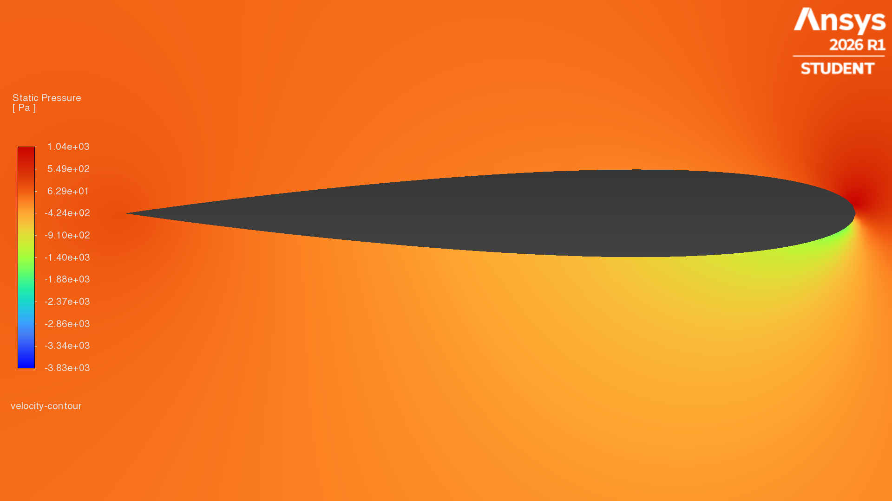
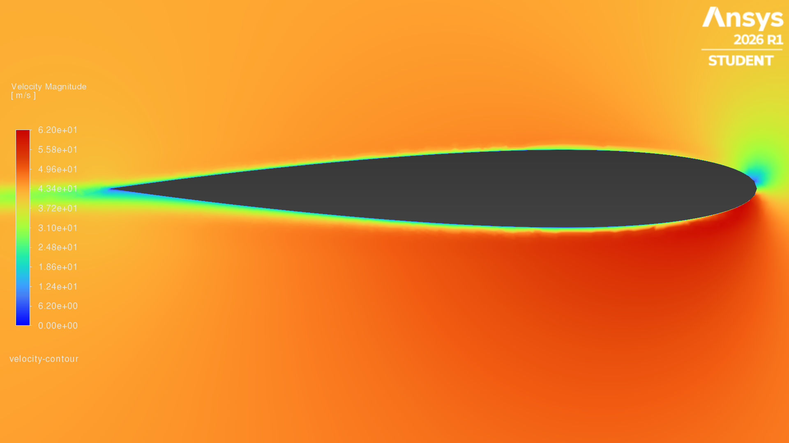

# NACA 0012 Airfoil CFD & Python-Based Experimental Comparison

<p align="center">
  
  
  <a href="LICENSE"></a>
</p>

## Description

A Python-based workflow for analysing two-dimensional computational fluid dynamics (CFD) simulations of a NACA 0012 airfoil at a Reynolds number of $Re = 3 \times 10^6$. The project combines steady-state Reynolds-averaged Navier–Stokes (RANS) simulations in Ansys Fluent with Python-based processing of surface pressure coefficient ($C_p$) data and comparison against NASA Langley experimental measurements (Ladson, 1988).

The workflow includes data parsing, pressure-based lift estimation, visualisation of CFD and experimental results, and an investigation of mesh sensitivity using three mesh resolutions. Python routines were also developed to implement Roache's Grid Convergence Index (GCI) methodology to investigate discretisation uncertainty.

---

## Key Validation Highlights

<p align="center">
  
</p>

---

## Turbulence Modelling and Wall Resolution

- **Turbulence Model**: Used the $k\text{-}\omega$ Shear Stress Transport (SST) model for the reported simulations. The model combines near-wall $k\text{-}\omega$ behaviour with $k\text{-}\varepsilon$-based behaviour in the outer flow and is commonly used for aerodynamic flows involving adverse pressure gradients.
- **Near-Wall Mesh**: Targeted a dimensionless wall distance of $y^+ < 1$ on the fine mesh. The initial wall-adjacent cell height was estimated as $\Delta y_1 = 8.45 \times 10^{-6}\text{ m}$ for the chosen flow conditions. The resulting $y^+$ distribution should be checked in Fluent to confirm that the target was achieved.

---

## Mesh Sensitivity Analysis

Three mesh resolutions were investigated at an angle of attack of $4^\circ$ and a Reynolds number of $3 \times 10^6$.

| Mesh Level | Cell Count | Lift Coefficient ($C_L$) |
| :--- | :--- | :--- |
| **Coarse** | ~15,000 | 0.43585 |
| **Medium** | ~45,000 | 0.43633 |
| **Fine** | ~130,000 | 0.40688 |

The coarse- and medium-mesh lift coefficients are similar, whereas the fine-mesh result shows a larger difference. This indicates that the recorded results do not demonstrate straightforward monotonic convergence.

Python routines were developed to investigate discretisation uncertainty using Roache's Grid Convergence Index (GCI) methodology. However, the recorded lift coefficients do not show straightforward monotonic convergence, so the refinement assumptions and results require further investigation before a reliable GCI estimate can be reported.

---

## Experimental Comparison with NASA Data

The CFD surface-pressure coefficient ($C_p$) distribution was compared with NASA Langley experimental data for the NACA 0012 airfoil at $Re = 3 \times 10^6$ and an angle of attack of $4^\circ$. Python routines process the CFD and experimental data to generate comparative plots and estimate lift by numerically integrating the pressure difference between the upper and lower surfaces. Quantitative agreement and the influence of mesh resolution require further assessment.

---

## Additional Analysis Plots

The figures below show the recorded lift-coefficient trends and exploratory mesh-sensitivity analysis. The mesh results require further investigation before a reliable grid-convergence conclusion can be drawn.

<p align="center">
  
  
</p>

---

## Ansys Fluent Flow Visualisation ($\alpha = 4^\circ$, $Re = 3 \times 10^6$)

<p align="center">
  
  
</p>

- **Static Pressure:** Shows the pressure distribution around the airfoil, including the leading-edge stagnation region and variations in surface pressure.
- **Velocity Magnitude:** Shows the computed velocity field around the airfoil and in the downstream wake.

---

## Python Workflow and Design

The Python workflow separates data processing, numerical analysis and visualisation into dedicated modules.

- `src/parser.py`: Parses CFD exports and NASA benchmark data into structured dataframes.
- `src/metrics.py`: Implements numerical routines for pressure-based lift estimation and GCI analysis.
- `src/visualization.py`: Generates plots for comparing surface-pressure distributions and visualising simulation results.
- `src/dataset.py`: Organises simulation data through the `SimulationDataset` class.
- `project.py`: Provides the main entry point for running the analysis workflow.
- `test_project.py`: Contains unit tests for the implemented parsing and numerical functions.

---

## Repository Structure

```text
naca0012-cfd-python-validation/
├── data/
│   ├── benchmark/          # NASA Ladson CP_Ladson.dat data
│   └── raw/                # Fluent surface pressure & y+ CSV exports
├── reports/
│   └── figures/            # Exported high-res validation plots
│       └── validation_summary.csv
├── src/
│   ├── dataset.py          # SimulationDataset OOP module
│   ├── metrics.py          # Trapezoidal integration & GCI functions
│   ├── parser.py           # Ansys CSV & NASA dat parsing routines
│   └── visualization.py    # Matplotlib figure generation functions
├── project.py              # Primary CLI application
├── test_project.py         # PyTest unit testing suite
├── LICENSE                 # MIT License file
└── requirements.txt        # Clean python dependency specifications
```
---

## Quickstart & CLI Usage

### 1. Install Dependencies
```bash
pip install -r requirements.txt
```
### 2. Generate Validation Pipeline & Figures
```bash
python project.py --export-plots